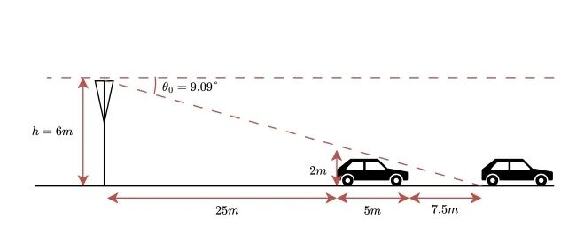
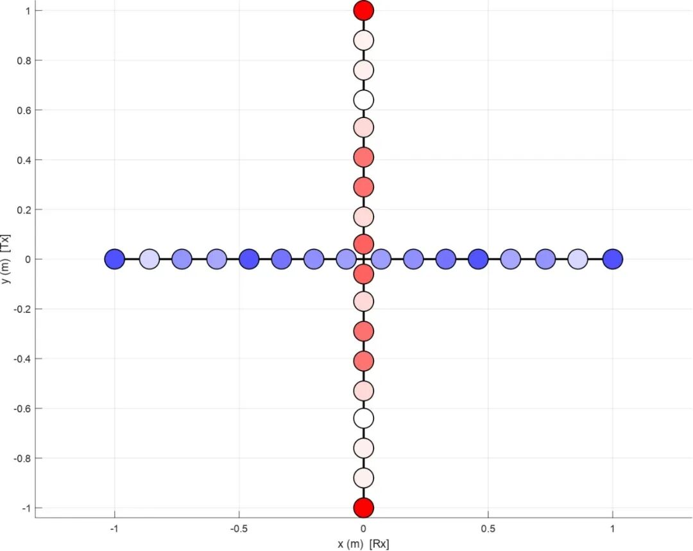
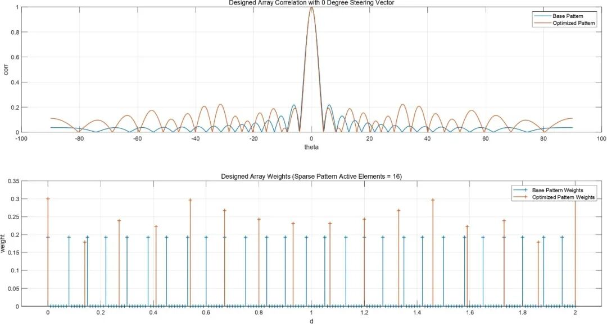
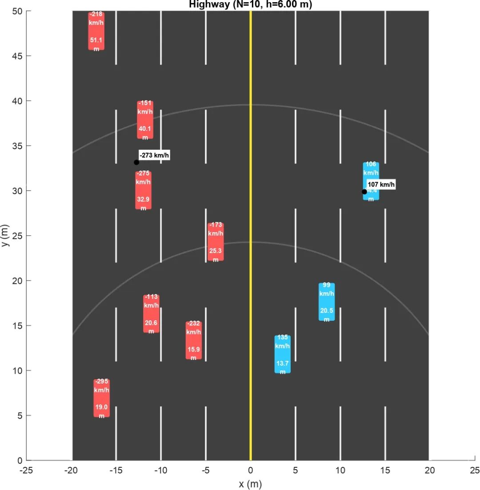
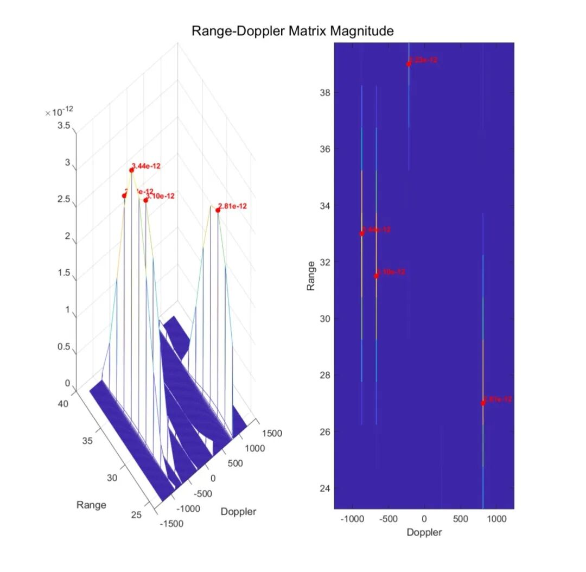

# Radar Signal Processing: Cross-Array Radar: Solving the Technological Challenges of Vehicle Speed and Position Detection on Highways [with MATLAB Code]

Cross-array radar: Solving the technical challenges of highway vehicle speed and position detection. In the era of rapid development of intelligent transportation systems (ITS), the intelligent monitoring of highways has become one of the core directions in technological research and development in the field of transportation. Radar detection technology, with its unique advantages of all-weather operation and unaffected by adverse weather conditions, has become a core means for vehicle speed and position detection. However, the traditional onboard radar's uniform linear array design is always limited by issues such as high cost, significant crosstalk effects, and numerous elements. Moreover, under the dual demands of large horizontal visibility coverage and high resolution detection, the optimization of array design has become an urgent technological bottleneck to be broken through.
Based on convex optimization and sparse reconstruction in signal processing theory, we designed and implemented a cross-array radar speed and positioning system for highway vehicle monitoring. Innovatively, the cross layout is separated into an array of transmitters and receivers. Under the application scenario where the physical size of the array is strictly limited (...), it achieves precise estimation of vehicle distance, speed, and position in low SNR environments. This provides an efficient and robust technical solution for intelligent monitoring on highways.
1. Cross-array: Breaking through the constraints of traditional array designs. In pursuit of large aperture and high resolution, uniform linear arrays often require an increase in the number of elements, which not only raises hardware costs but also exacerbates the mutual coupling effects between elements, affecting detection accuracy. Additionally, the installation environment on highway median barriers imposes stringent physical size restrictions on radar arrays, necessitating that array design find an optimal solution between "small size" and "high performance."
The cross-array configuration we propose achieves the functional separation of the transmitting and receiving arrays through layout design: The transmitting array is placed vertically (y-axis), while the receiving array is horizontally (x-axis). The radar system is mounted at a specified height on the central median strip of the highway, establishing a Cartesian coordinate system based on the radar position. The ground is considered a plane, and the coordinates of the target vehicles are established accordingly.
In conjunction with geometrical relationships, we have defined the slant range of the target to the radar:
The pitch angle is determined by geometrical relationships:
The introduction of receiving array measurement angle parameters, which meet the requirements for azimuth angles. For ground vehicle targets, precise estimation of azimuth angles can be achieved through solving this geometric model, laying a solid theoretical foundation for subsequent parameter estimation and giving the cross-array an inherent layout advantage in covering a wide horizontal field of view on roads.
II. Sparse Optimization: The performance maximization of small-sized arrays is limited by the physical size of the array. This limits our ability to improve performance by increasing the number of elements. However, sparse array design theory provides us with new ideas—by optimizing the position and weight of elements within the restricted aperture, we can maximize antenna gain and angle resolution while effectively suppressing sidelobe interference. Based on convex optimization theory, we have designed targeted sparse optimization for both transmitting and receiving arrays, allowing the limited number of elements to achieve optimal detection performance.
Transmitting Array: The core requirement of the transmitting array is to form a directed beam pointing at a specific elevation angle. We set the grid interval as, constructing continuous optimization variables, with minimizing peak sidelobe level beyond the main lobe as the core optimization objective, establishing a strict convex optimization mathematical model:
In which represents the steering vector, including phase shift factors pointing towards. Under the constraints of ensuring that the sum of element weights equals 1 and individual weight lies within the range, the modulus of the weighted steering vector in the non-main lobe area is not allowed to exceed the peak sidelobe level. After solving the optimization variables, peak detection is used to extract the positions and corresponding weights of sparse elements, accurately directing the beam of the transmitting array to the detection area to reduce energy loss.
Receiver Array: Wide field of view sidelobe suppression requires the receiver array to have a wide horizontal field of view for detection. Therefore, its optimization design focuses on sidelobe suppression in non-interested areas. The convex optimization model for this design is:
Under the premise of ensuring basic constraints on element weights, the weighted modulus of the steering vector in the non-interested area is not allowed to exceed, ensuring that the receiver array maintains high gain in the nearby main lobe area while effectively suppressing far-end sidelobe interference, avoiding the impact of clutter in non-detection areas on detection results, ensuring precision in the wide field of view.
III. Signal Processing: A Full-Link Precision System for Generation to Calculation
A high-performance radar speed and positioning system requires not only excellent array design but also a complete signal processing chain as its support. We use linear frequency modulation (LFM) waveforms as the transmit signals, combined with distance-Doppler processing for target detection, followed by angle superresolution estimation in the sparse domain using matched filtering algorithms, and finally achieve target positioning and speed measurement through geometric calculations. This establishes a full-link precision processing flow from signal generation to parameter calculation, with all models and algorithms rigorously derived through mathematical deductions and engineering validation.
Linear Frequency Modulation Signal: The basic radar transmission model of a linear frequency modulation pulse signal is:
In which, denotes the signal bandwidth, and denotes the pulse width. This signal form features large bandwidth and wide time span, which can be effectively compressed through subsequent matched filtering to improve radar range resolution, providing a solid signal foundation for distinguishing and detecting close-range vehicles.
The received signal takes into account the target delay and Doppler shift in actual detection scenarios, the received signal model for each receiving element is:
In which denotes the target delay, denotes the Doppler shift, and are the steering vectors of the receiving and transmitting arrays, respectively, denotes environmental noise. This model highly aligns with the actual detection scenarios on highways, ensuring the accuracy of signal modeling.
Distance-Doppler Processing: Target detection's core process is the distance-Doppler processing. Firstly, we perform matched filtering on each receiving pulse to achieve distance compression:
This increases the signal's distance resolution to the limit level corresponding to the bandwidth; then, perform fast Fourier transform (FFT) along the slow time dimension to extract Doppler information, generating a distance-Doppler map:
By setting an appropriate detection threshold, peaks in the map are detected, extracting the target's corresponding distance units and Doppler unit indexes, thus quickly completing the preliminary detection of multiple vehicle targets on highways, determining the approximate distance and Doppler frequency range of the targets, selecting effective targets for subsequent precise parameter estimation.
Matching pursuit: Super-resolution estimation in the angle domain due to sparse array design. The traditional beamforming algorithm's performance in estimating angles is significantly limited by the use of a sparse array. Therefore, we introduce the matching pursuit algorithm to achieve super-resolution estimation within the sparse domain. For detected targets, we construct an angle dictionary for the receiving array, where each column corresponds to a possible directional vector of an angle. By iteratively solving the sparse optimization problem:  
Selecting the atom with the highest correlation with the residual as the target angle estimate. This algorithm fully leverages the structural characteristics of the sparse array, breaking through the resolution limit of traditional algorithms, achieving precise estimation of azimuth angles even with limited number of elements, addressing the core challenge of angle estimation in sparse arrays.  
Geometric solution: Realization of speed and position measurement. After obtaining estimated values of range and angle, combined with our initially constructed geometric model, accurate Cartesian coordinates and moving speed can be obtained through rigorous mathematical calculations. Firstly, the estimated value of pitch angle is solved using the following formula:  
Further calculation yields the target's transverse and longitudinal coordinates, achieving precise vehicle positioning:  
The speed estimation combines Doppler shift with the main movement characteristics of highway vehicles along the road's longitudinal (y-axis), and calculates the actual vehicle speed using the following formula:  
This formula corrects the conversion deviation between Doppler shift and actual speed, making the speed measurement more aligned with the actual movement of highway vehicles, ensuring accuracy in speed measurement.  
Technical verification: Robustness and effectiveness under low signal-to-noise ratio. To verify the practical performance of this cross-array radar speed and positioning system, we have built a complete simulation platform based on MATLAB, replicating various vehicle target detection scenarios at different speeds and distances on the highway, and conducted extensive simulation tests under low signal-to-noise ratio conditions.
Simulation results show that under the strict constraints of array physical size, the sparse array designed by convex optimization can effectively suppress sidelobe interference. Combined with distance-Doppler processing and matched tracking algorithm, it can achieve rapid detection of multiple vehicle targets, and the estimated values of vehicle distance, speed, and position are extremely close to the actual values. Even in low signal-to-noise ratio environments, the system maintains high estimation accuracy without significant detection omissions or parameter estimation deviations. This fully validates the effectiveness, robustness, and environmental adaptability of the system design, as well as the practicality of all theoretical models and mathematical formulas.
V. Technology Outlook: A New Direction for Intelligent Traffic Surveillance
In future research and engineering implementations, we can further optimize the miniaturization and integration of the array based on the actual installation environment of expressway. At the same time, multi-object tracking algorithms are introduced to achieve continuous detection and trajectory tracking of vehicle targets. Additionally, this system can be integrated with video surveillance, millimeter wave radar networks, etc., to build a smart highway monitoring system that integrates multiple sensors, providing more comprehensive and precise technical support for traffic control, accident warning, and vehicle-road collaboration in expressways.
From single speed and position detection to multidimensional intelligent monitoring, radar technology's application in the field of intelligent transportation is continuously deepening. The design and implementation of cross-array radar are just a microcosm of intelligent transportation technology research and development. In the future, as theories and technologies such as convex optimization, sparse reconstruction, and artificial intelligence continue to integrate, highway intelligent monitoring will develop towards more precise, more efficient, and smarter directions, safeguarding the safety and convenience of traffic travel.

## Images

<!-- PAYMENT_BLOCK -->

## Get this dataset

- Payment link (Stripe): [Buy now](https://buy.stripe.com/3cs8yP7sY87d0vu9AB)
- Payment QR code: 

<!-- /PAYMENT_BLOCK -->
